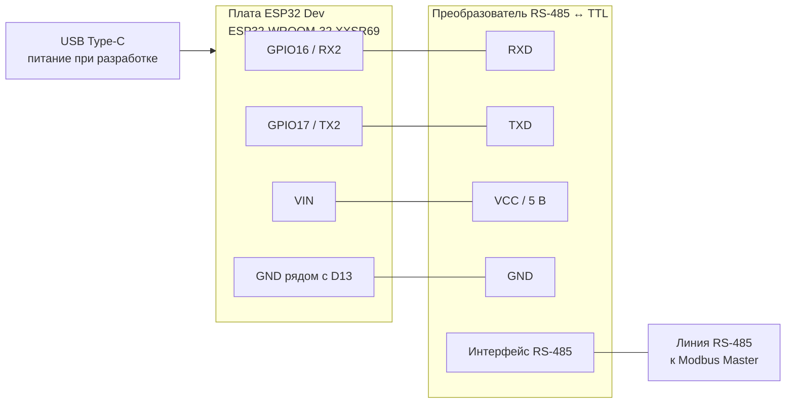

# Оборудование и подключение

## Состав модуля

- Модуль ESP32-WROOM-32 с маркировкой `XXSR69`, установленный на плату ESP32 Dev.
- Преобразователь RS-485 ↔ TTL; на предоставленном изображении со стороны TTL видны контакты `VCC`, `TXD`, `RXD`, `GND`, со стороны шины — `A+` и `B−`. По сообщению владельца, питание составляет 5 В, уровень на стороне TTL — 3,3 В, а указанные 4,8 В относятся к стороне RS-485. Направление передачи переключается автоматически, DE/RE не используются. Название модели и маркировка микросхем по изображению не определены. На изображении также присутствует контакт с маркировкой «接地»; его назначение в реальном монтаже не подтверждено.
- Во время разработки ESP32 и преобразователь питаются от общего источника через USB Type-C платы ESP32. По сообщению владельца, `VCC` преобразователя подключён к `VIN` ESP32, а `GND` преобразователя — к выводу `GND` рядом с `D13` на плате ESP32.

## Схема соединений по описанию владельца

Владелец подтвердил соединения VIN–VCC, GND–GND, GPIO16–RXD и GPIO17–TXD. При таком подключении обмен с Modbus Master работает в обе стороны. Уровень стороны TTL указан как 3,3 В. Схема линии RS-485 и остальные устройства на ней находятся вне проекта.

## Кнопка заводского сброса

Владелец предусмотрел подключение физической кнопки к выводам ESP32. Удержание кнопки не менее 3 секунд должно возвращать все сохранённые настройки к первоначальному состоянию, включая настройки точки доступа, пароль администратора, подключение к роутеру, MQTT и Telegram. Текущая установленная версия прошивки сохраняется. После сброса устройство требует первоначальной настройки. Для кнопки при реализации можно выбрать подходящий свободный GPIO; необходимо предусмотреть устранение дребезга. Кнопка и функция сброса пока не реализованы; GPIO и схема подключения ещё не выбраны.

Назначение контактов и работа двустороннего обмена для приведённого подключения подтверждены владельцем на практике.

## Параметры прошивки

`platformio.ini` использует плату PlatformIO `esp32dev`. В `src/main.cpp` порт `Serial2` настроен на 9600 бод, 8N1, RX GPIO 16 и TX GPIO 17; Modbus Slave ID — 16. Отдельное управление DE/RE не требуется: преобразователь переключает направление автоматически.

## Что ещё требуется уточнить

- Маркировка или модель платы преобразователя и его микросхемы.
- При реализации выбрать подходящий свободный GPIO и зафиксировать схему подключения кнопки заводского сброса.

## Прошивка и восстановление

Обычная прошивка выполняется через расширение PlatformIO в Visual Studio Code; сейчас используется порт COM6. Номер порта может измениться при другом подключении. После неудачного обновления необходимо перепрошить ESP32 через USB.
